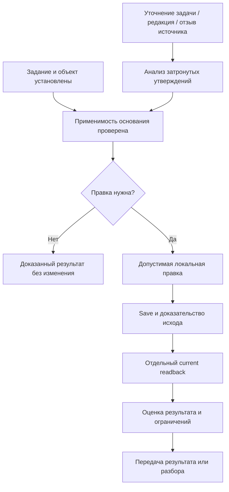

# Utility GIS Editor: жизненный цикл основания правки

## Предмет и способ исследования

Разобран UseCase из `RAW_inputs/documents/UtilityGisEditorRole.md`: поддержание объяснимой модели инженерной сети через задания, редактирование, проверку, согласование, полевые материалы и эксплуатационные потребности. Акцент этого прохода — 15 вопросов discovery о том, как меняются задание и основание после сохранения. Ответы находятся в соседнем файле `2026-10-19-utility-gis-editor-change-basis-answers.md`.

Оба документа используют общий корпус **77 различных прочитанных веб-документов**. В каждом приведён полный реестр; это 77 документов, а не 154 независимых исследования. Для больших стандартов прочитаны релевантные разделы, а не заявлено сплошное чтение каждой страницы. Поиск охватил эксплуатацию water/wastewater и electric networks, подземные коммуникации, SUE, field-office exchange, provenance, metadata, версии и качество данных. Приоритет — официальная документация продукта, стандарты и документы организаций, непосредственно управляющих данными. Поисковые сниппеты не включены в доказательную базу.

Кластеры источников зависимы: десятки страниц Esri описывают одну продуктовую модель, PROV-O и PROV-DM — разные документы одной системы стандартов. Число URL не является числом независимых подтверждений. FHWA, Watercare, HSE, PHMSA, NUAR, Ofgem, W3C/OGC, USGS, QField и Giswater добавляют другие предметные и методические перспективы. Документы на `latest`/`master` проверены 2026-10-19; их содержание впоследствии может измениться.

Недоступные страницы не учитывались: прежние адреса Workflow Manager attachments/job-history, USGS data-versioning/data-release, английский адрес Giswater Audit, OGC sprint report 23-059, Esri archiving-scenarios и старый адрес error-life-cycle, Field Maps high-accuracy. Каталожная страница Ofgem не считается отдельным источником от прочитанного PDF. Пропуски номеров S оставлены для прозрачности. Три дополнительно открытых Watercare PDF не включены: глубокое чтение их содержимого в этом проходе не завершено.

**Происхождение утверждений:** внешние факты обозначены ссылками S; аналитические выводы — рассуждения агента; решения условной организации приняты агентом в роли `02_expert_oldman_ufa` согласно действующему режиму проекта. Это не интервью, не производственные измерения и не подтверждение внедрения. Confidence high означает надёжную фиксацию найденного текста и принятого решения, а не измеренную эффективность правил.

## Проверка исходного UseCase

| Контур исходника | Что подтверждено корпусом | Что нельзя из этого заключить |
| --- | --- | --- |
| Редактирование сети | Geometry, отношения и атрибуты имеют различные последствия; network-aware инструменты применяют правила [S61](https://doc.esri.com/en/arcgis-pro/latest/help/data/utility-network/about-terminal-management.html)–[S70](https://doc.esri.com/en/arcgis-pro/latest/help/data/utility-network/about-error-features.html), [S79](https://doc.esri.com/en/arcgis-pro/latest/help/editing/utility-network-reference-for-editing.html)–[S80](https://doc.esri.com/en/arcgis-pro/latest/help/editing/edit-a-utility-network.html) | Одинаковая форма не означает одинаковую сеть; GeoService не реализует весь Utility Network |
| Версионная работа | Reconcile, разрешение конфликтов, post и просмотр differences разделены [S45](https://doc.esri.com/en/arcgis-pro/latest/help/data/geodatabases/overview/reconcile-and-post-edits-to-a-branch-version.html)–[S47](https://doc.esri.com/en/arcgis-pro/latest/help/data/geodatabases/overview/version-changes-branch.html) | Save не равен публикации; default продукта не является правилом нашей организации |
| Проверка качества | Immediate/deferred rules, dirty areas, correction/verification и обновление subnetwork различаются [S48](https://doc.esri.com/en/arcgis-pro/latest/help/data/geodatabases/overview/an-overview-of-attribute-rules.html)–[S50](https://doc.esri.com/en/arcgis-pro/latest/help/data/utility-network/validate-a-network-topology.html), [S72](https://doc.esri.com/en/arcgis-pro/latest/help/data/utility-network/update-a-subnetwork.html), [S86](https://pro.arcgis.com/en/pro-app/latest/help/data/validating-data/results-and-life-cycle-phases.htm) | Отсутствие ошибки в одном прогоне не удостоверяет все свойства и всю область |
| Полевые материалы | Наблюдения, GNSS metadata, вложения, схемы пакета и delta sync имеют самостоятельный смысл [S21](https://docs.qfield.org/reference/qfieldcloud/jobs/)–[S26](https://docs.qfield.org/get-started/tutorials/permissions/), [S30](https://docs.giswater.org/master/en/docs/giswater/for-users/dialogs/add-visit.html), [S38](https://www.w3.org/TR/vocab-ssn/), [S85](https://doc.arcgis.com/en/field-maps/android/use-maps/configure-field-maps.htm) | Загруженный файл не принят автоматически; фото не устанавливает точность всей линии |
| Эксплуатационный результат | Происхождение, охват, состояние актива и сценарий расчёта важны потребителю [S28](https://docs.giswater.org/master/en/docs/giswater/for-users/dialogs/replace-feature.html)–[S36](https://docs.giswater.org/master/en/docs/giswater/for-users/dialogs/result-manager.html), [S39](https://www.npms.phmsa.dot.gov/PipelineData.aspx)–[S43](https://www.gov.uk/government/publications/national-underground-asset-register-project-update-november-2023/nuar-project-update-november-2023), [S75](https://docs.ogc.org/is/23-024/23-024.html), [S81](https://www.ofgem.gov.uk/sites/default/files/2025-11/Data_Best_Practice_Guidance_CLEAN%26ACC.pdf) | Редакция карты не подтверждает физическое строительство, ввод или разрешение земляных работ |

Исходные утверждения о «двух самых частых архитектурах», распространённости боли, эффекте обучения, рыночной доле, текущих issue и экономии времени этим корпусом не доказаны. Наличие возможностей в документации подтверждает возможности, но не частоту использования. Оpaque `turn...` ссылки старого RAW не переиспользуются как доказательства. Исторические NUAR 2023 и FHWA описываются в своём времени; зарубежные требования служат сравнительными примерами, не применимым к GeoService законодательством.

## Новые знания относительно прохода 2026-10-18

Предыдущий анализ уже разделял observation/acceptance, authority по категориям, asset identity, представление/сеть, охват проверки, connectivity/traversability, operational state, сценарий, CRS/точность, sync и разрешение физических работ. Ниже — уточнения с новым правилом или новой областью последствий, а не переименование прежних выводов.

### N01. Редакция основания — отдельная ось изменения

**Факты:** DCAT различает версии ресурсов и их описаний; USGS определяет уровни пересмотра по влиянию на использование, включая редакторские изменения и отзыв [S03](https://www.w3.org/TR/vocab-dcat-3/), [S54](https://www.usgs.gov/office-of-science-quality-and-integrity/guidance-documenting-revisions-usgs-scientific-digital-data). Ofgem V3.2 демонстрирует изменение доступности документа без изменения содержания [S81](https://www.ofgem.gov.uk/sites/default/files/2025-11/Data_Best_Practice_Guidance_CLEAN%26ACC.pdf).

**Вывод:** одинаковые координаты не доказывают неизменность смысла. Исправление названия улицы может быть орфографией, а может переназначить наблюдение другой линии. Классификация определяется последствиями, не названием поля.

**Решение:** фиксировать новую редакцию основания и её влияние на объект, участок, время, метод, критерий и вывод. При доказанной смысловой эквивалентности достаточно актуализировать ссылку с записью причины; иначе переоценить затронутые выводы. Геометрическое сохранение ради смены ссылки не требуется. Новизна к N12 прежнего анализа: задан триггер и процедура пересмотра, а не только необходимость provenance.

### N02. Достаточность свидетельств оценивается по происхождению

**Факты:** PROV различает derivation, quotation, revision и primary source [S01](https://www.w3.org/TR/prov-o/)–[S02](https://www.w3.org/TR/prov-dm/); MUDDI связывает underground information с измерениями [S75](https://docs.ogc.org/is/23-024/23-024.html). Фото с нанесённой аннотацией — поддерживаемый способ представления [S23](https://docs.qfield.org/how-to/project-setup/pictures/).

**Вывод:** DWG, PDF и скриншот одного замера образуют одну цепь наблюдения. Они могут помогать интерпретации, но не дают трёх независимых измерений. Даже два прибора могут иметь общий ошибочный datum; независимость имеет область.

**Решение:** записывать корневое наблюдение и преобразования, а неизвестную зависимость явно отмечать. Достаточность решать по пригодности и принятому критерию, не большинством совпадающих файлов. Универсальный числовой коэффициент доверия не вводится. Новизна к прежней authority-модели: авторитетный издатель копии не устраняет общую ошибку первоисточника.

### N03. Время наблюдения нельзя заменить временем поступления

**Факты:** SSN/SOSA различает phenomenonTime и resultTime [S38](https://www.w3.org/TR/vocab-ssn/); NPMS отдельно указывает дату отражаемых полевых условий и сроки подачи [S39](https://www.npms.phmsa.dot.gov/PipelineData.aspx). Editor tracking относится к записи в систему [S57](https://doc.esri.com/en/arcgis-pro/latest/help/data/geodatabases/overview/introduction-to-editor-tracking.html).

**Вывод:** время получения, публикации, наблюдения и сохранения отвечают на разные вопросы. Свежая загрузка старой схемы не доказывает текущего состояния сети.

**Решение:** неизвестную дату наблюдения сохранять как неизвестную; пересмотреть выводы об актуальности и последовательности физических изменений. Пригодность для исторической идентификации может сохраниться. Синтетические примеры не превращаются в фактические даты. Новизна: конкретная временная неопределённость и её распространение на зависимые решения.

### N04. Отзыв источника меняет применимость вывода, но не стирает событие

**Факты:** PROV позволяет выразить invalidation; USGS описывает отзыв существенно ошибочных данных с сохранением прежней версии для понимания зависимых работ [S01](https://www.w3.org/TR/prov-o/), [S54](https://www.usgs.gov/office-of-science-quality-and-integrity/guidance-documenting-revisions-usgs-scientific-digital-data).

**Вывод:** факт Save остаётся фактом, но его обоснованность может быть утрачена. Другой источник способен обосновать ту же геометрию, если не наследует отозванную ошибку.

**Решение:** найти затронутые утверждения и результаты, снять прежнее заключение с текущего использования, проверить альтернативное основание и принять новое решение с фактическим временем. Автоматический Revert или автоматическое сохранение прежнего approval запрещены как организационная подмена анализа. Новизна: отзыв основания обработан отдельно от ошибки геометрии и отмены наряда.

### N05. История задания, история объекта и история обоснования различаются

**Факты:** Workflow Manager хранит этапы и назначения [S53](https://doc.arcgis.com/en/workflow-manager/latest/help/view-job-history.htm); editor tracking хранит создание/последнюю правку [S57](https://doc.esri.com/en/arcgis-pro/latest/help/data/geodatabases/overview/introduction-to-editor-tracking.html); Giswater Audit реконструирует состояние из снимков и зарегистрированных операций [S29](https://docs.giswater.org/master/ca/docs/giswater/for-users/additional-toolbars/audit.html).

**Вывод:** один last_edited timestamp не восстанавливает все решения. Историческая карта отражает зарегистрированное состояние при конкретном охвате аудита, не гарантированную истину на местности.

**Решение:** связывать задачу, сохранение, редакцию основания и заключение, не объявляя их одной транзакцией. В ручной карточке явно отмечать пробелы аудита. Новизна к хранению истории: сформулирован предел реконструкции и раздельный предмет трёх журналов.

### N06. Возврат формы не является возвратом знания

**Факты:** Discard относится к несохранённым правкам [S60](https://doc.esri.com/en/arcgis-pro/latest/help/editing/save-or-discard-edits.html); исторический просмотр Giswater может создавать временные слои без изменения operational data [S29](https://docs.giswater.org/master/ca/docs/giswater/for-users/additional-toolbars/audit.html); Differences сравнивает конкретные версии [S47](https://doc.esri.com/en/arcgis-pro/latest/help/data/geodatabases/overview/version-changes-branch.html).

**Вывод:** восстановить прежнюю координату можно только как новое актуальное решение. Отозванное основание, изменившиеся права и новые сведения не исчезают вместе с последним сдвигом.

**Решение:** отдельно выбирать технический способ и смысл восстановления: локальный Cancel, новая корректирующая запись ранее сохранённой формы либо Revert к immutable baseline. Проверять актуальные guards и результат; не переписывать baseline. Новизна: выбор промежуточного сохранённого состояния вместо необоснованного полного сброса.

### N07. Частичный результат требует проверки зависимостей

**Факты:** Workflow Manager поддерживает зависимости заданий и holds [S10](https://doc.arcgis.com/en/workflow-manager/latest/help/dependencies.htm)–[S11](https://doc.arcgis.com/en/workflow-manager/latest/help/manage-holds.htm), [S77](https://doc.arcgis.com/en/workflow-manager/latest/help/work-on-jobs.htm); Data Reviewer отделяет correction от verification [S86](https://pro.arcgis.com/en/pro-app/latest/help/data/validating-data/results-and-life-cycle-phases.htm).

**Вывод:** завершённый шаг и полезный самостоятельный результат не всегда совпадают. Исправление одной координаты может создать ложное впечатление завершения реконструкции всей ветви.

**Решение:** выделять частичный результат только при собственной цели, области, основании и отсутствии незакрытой зависимости, делающей его вводящим в заблуждение. Остаток работы и ограничения передавать явно. Новизна: проверка самостоятельности через зависимости, а не процент готовности.

### N08. Граница принятия проходит внутри материала

**Факты:** SUE допускает разное качество обследования вдоль маршрута [S05](https://www.fhwa.dot.gov/programadmin/sueindex.cfm)–[S08](https://www.fhwa.dot.gov/construction/dabs/library_hif24094.pdf); визит содержит несколько параметров и документов [S30](https://docs.giswater.org/master/en/docs/giswater/for-users/dialogs/add-visit.html); DQV оценивает качество в контексте [S04](https://www.w3.org/TR/vocab-dqv/).

**Вывод:** принятие XY одного участка не распространяется на глубину, соседний участок или эксплуатационное состояние из того же файла.

**Решение:** вести карту «утверждение — объект/участок — свойство — редакция — решение — причина». Непринятое разделять на отклонённое и ещё не проверенное; противоречащие сведения сохранять. Новизна к частичному принятию 2026-10-18: операционный способ локализации и защита от распространения acceptance на весь файл.

### N09. Исправление данных и физическое изменение имеют разные временные модели

**Факты:** Replace/End/Divide/Fuse в Giswater описывают различные операции [S28](https://docs.giswater.org/master/en/docs/giswater/for-users/dialogs/replace-feature.html), [S32](https://docs.giswater.org/master/en/docs/giswater/for-users/dialogs/end-feature.html)–[S34](https://docs.giswater.org/master/en/docs/giswater/for-users/dialogs/arc-fusion.html); planned и operative разделены [S31](https://docs.giswater.org/master/en/docs/giswater/for-users/dialogs/new-psector.html); network relations могут сохраняться при другой форме [S61](https://doc.esri.com/en/arcgis-pro/latest/help/data/utility-network/about-terminal-management.html)–[S68](https://doc.esri.com/en/arcgis-pro/latest/help/data/utility-network/set-edge-connectivity-for-line-features.html).

**Вывод:** «исправили ошибку о прежнем положении» и «актив перемещён» могут дать одинаковые XY, но требуют разных свидетельств, effective time и идентичности.

**Решение:** смена такой классификации считается существенным изменением задачи. Ближайший geometry-only срез не получает скрытую возможность замены, строительства или вывода актива. Новизна: критерий прекращения прежней работы при смене смысла без изменения координат.

### N10. Передача ответственности и принятие правильности — разные решения

**Факты:** reassignment/hold/closure имеют отдельные права и записи [S53](https://doc.arcgis.com/en/workflow-manager/latest/help/view-job-history.htm), [S77](https://doc.arcgis.com/en/workflow-manager/latest/help/work-on-jobs.htm)–[S78](https://doc.arcgis.com/en/workflow-manager/latest/administer/users-groups-roles-and-privileges.htm); acceptance актива и комплект документов разделены у Watercare [S41](https://www.watercare.co.nz/builders-and-developers/compliance/certificate-of-acceptance); preliminary и approved различаются у USGS [S83](https://www.usgs.gov/survey-manual/5028-fundamental-science-practices-review-approval-and-release-usgs-scientific-data).

**Вывод:** получатель может принять расследование с незавершённой оценкой. Это не подтверждает геометрию и не закрывает quality case.

**Решение:** при передаче записывать принятую обязанность, текущее сохранённое состояние, известный исход, основания, неизвестное и следующий шаг. Новизна к прежней передаче: явная семантика подтверждения получателем «принял разбор», отдельно от «принял результат».

## Согласованная модель UseCase

Это аналитическая последовательность действий, не новая серверная state machine. WorkOrder задаёт намерение; EditVersion — существующую границу согласованности сохранённых изменений. Основание и оценка могут пока оставаться ручной документацией. Полевая съёмка, revision источника и геометрический Save не образуют распределённую атомарную транзакцию. Не доказана необходимость нового aggregate, saga, CQRS или автоматического движка доверия.

| Изменение | Что проверить повторно | Что нельзя сделать автоматически |
| --- | --- | --- |
| Орфография без смены референта | Доказать смысловую эквивалентность | Объявить любое текстовое изменение несущественным |
| Новый объект/участок/тип намерения | Идентичность, объём задания, применимость правки | Продолжить под прежним объяснением |
| Отзыв/ошибка исходника | Все зависимые утверждения в затронутой области | Считать альтернативную копию независимой |
| Неизвестная дата наблюдения | Актуальность, effective time, порядок изменений | Подставить дату загрузки |
| Исправление последнего Save | Пригодность выбранного прежнего состояния и актуальные guards | Удалить события или заменить baseline |
| Передача незавершённого разбора | Явное принятие обязанностей и перечень неизвестного | Превратить получение карточки в approval |

## Границы ближайшего кода и нерешённые вопросы

Принятый срез — одна существующая line feature, одна внутренняя вершина, immutable baseline, server-side canonicalization и AOI CoveredBy; endpoints, associations, lifecycle актива не расширяются. `POSITIONAL_ACCURACY_UNVERIFIED` и `topologyChecked=not_checked` сохраняются. Позиционный критерий SIM-UGIS-POS-001 и правила review/post не изменены.

Source inspection в ходе discovery показывает backend Save/Revert/registry/readback, frontend выбор и сохранение. Кнопка сохранённого возврата ещё сообщает о недоступности; это нельзя выдавать за полностью работающий пользовательский сценарий. Фактическая БД, restart и end-to-end acceptance не проверялись. Новые правила относятся к ручному процессу до отдельной реализации; не добавляют обязательный API parameter или hard guard Save.

Остаются два прежних metadata/fixture вопроса, FU-2026-10-11-001 и реализация в FU-2026-10-13-004. Никакой источник не доказывает точность L-003. Эффективность предложенной карточки, трудозатраты и удобство передачи — непроверенные гипотезы. Для следующего исследования полезны новый предметный источник по корректировке исполнительной документации и проверка применимости к выбранному виду сети; число источников само по себе не заменяет такую проверку.

## Реестр прочитанных источников

Дата обращения для всех записей: 2026-10-19. Нумерация сохраняет исключённые попытки; в таблице ровно 77 документов. Колонка о новизне URL будет вычислена относительно корпуса 2026-10-18; она не утверждает, что источник впервые появился в мире или во всей истории проекта.

| ID | Документ | Прочитанное содержание и роль в анализе | Относительно реестра 2026-10-18 |
| --- | --- | --- | --- |
| S01 | [PROV-O](https://www.w3.org/TR/prov-o/) | PROV-O: revision, quotation, primary source и invalidation различаются; ссылка на копию не доказывает независимое наблюдение. | Новый URL |
| S02 | [PROV-DM](https://www.w3.org/TR/prov-dm/) | PROV-DM: derivation описывает получение сущности из другой; основание решения можно проследить через преобразования. | Повторно проверен |
| S03 | [DCAT 3 — versioning](https://www.w3.org/TR/vocab-dcat-3/) | DCAT 3, versioning: редакции dataset, distribution и metadata различаются; политика выпуска версий задаётся поставщиком. | Новый URL |
| S04 | [Data Quality Vocabulary](https://www.w3.org/TR/vocab-dqv/) | DQV: качество описывается для оценки пригодности к употреблению; единая универсальная оценка не предписана. | Новый URL |
| S05 | [Subsurface Utility Engineering - Subsurface Utility Engineering - Utility Program - Design - Federal Highway Administration](https://www.fhwa.dot.gov/programadmin/sueindex.cfm) | FHWA SUE: QL D/C/B/A отражают способ получения сведений; требуемая детализация зависит от риска и участка. | Новый URL |
| S06 | [Applying Subsurface Utility Engineering to Highway and Road Projects - Subsurface Utility Engineering - Utility Program - Design - Federal Highway Administration](https://www.fhwa.dot.gov/programadmin/sueshow.cfm) | FHWA, применение SUE: исходниками служат разные виды планов и записей; оцифровка сама может внести ошибку. | Новый URL |
| S07 | [SUE Then and Now - Subsurface Utility Engineering - Utility Program - Design - Federal Highway Administration](https://www.fhwa.dot.gov/programadmin/history.cfm) | FHWA, история SUE: обследование, surveying и управление данными образуют инженерный процесс; designating и locating различаются. | Новый URL |
| S08 | [TechBrief: Lessons Learned for the Development of Digital As Built of Aboveground Assets from Colorado Department of Transportation’s Subsurface Utility Program](https://www.fhwa.dot.gov/construction/dabs/library_hif24094.pdf) | FHWA HIF-24-094, стр. 5–6: CDOT объединяет survey, SUE, CAD и GIS; фазы проекта требуют разных данных. Это конкретный кейс. | Повторно проверен |
| S09 | [It gets MUDDI – a quest for better subsurface data (The MUDDI for everyone guide)](https://docs.ogc.org/guides/24-045.pdf) | OGC 24-045, раздел 4: подземные данные скрыты и разнородны; MUDDI связывает категории объектов. Руководство, не сам стандарт. | Новый URL |
| S10 | [Dependencies—ArcGIS Workflow Manager — Documentation](https://doc.arcgis.com/en/workflow-manager/latest/help/dependencies.htm) | Workflow Manager Dependencies: этапы могут зависеть от других заданий; завершение обследования может освобождать редактирование. | Новый URL |
| S11 | [Show and manage holds—ArcGIS Workflow Manager — Documentation](https://doc.arcgis.com/en/workflow-manager/latest/help/manage-holds.htm) | Workflow Manager Holds: отсутствие данных допускает приостановку; снятие hold — отдельное действие с правами. | Новый URL |
| S14 | [Manage jobs—ArcGIS Workflow Manager — Documentation](https://doc.arcgis.com/en/workflow-manager/latest/help/manage-jobs.htm) | Workflow Manager Manage jobs: закрытие и повторное открытие — действия workflow; техническая возможность закрыть не доказывает качество. | Новый URL |
| S16 | [Metadata Creation — U.S. Geological Survey](https://www.usgs.gov/data-management/metadata-creation) | USGS Metadata Creation: описание отвечает who/what/when/where/how/why; metadata нужно поддерживать при изменениях. | Новый URL |
| S17 | [Documenting Data Quality: Considerations — U.S. Geological Survey](https://www.usgs.gov/data-management/documenting-data-quality-considerations) | USGS Documenting Data Quality: фиксируются методы, flags, проверки и неопределённость, особенно для производных данных. | Повторно проверен |
| S18 | [Data Quality Assessment and Review: Recommended Practices — U.S. Geological Survey](https://www.usgs.gov/data-management/data-quality-assessment-and-review-recommended-practices) | USGS Assessment and Review: проверки выполняются в важных точках процесса, сравниваются история и полевые заметки. | Повторно проверен |
| S19 | [The Government Data Quality Framework - GOV.UK](https://www.gov.uk/government/publications/the-government-data-quality-framework/the-government-data-quality-framework) | UK Government Data Quality Framework: completeness, validity, accuracy и timeliness — разные измерения. | Новый URL |
| S20 | [The Government Data Quality Framework: guidance - GOV.UK](https://www.gov.uk/government/publications/the-government-data-quality-framework/the-government-data-quality-framework-guidance) | UK Framework guidance: качество и критичность данных оцениваются по использованию; ограничения сообщаются потребителю. | Новый URL |
| S21 | [Jobs - QField Ecosystem Documentation](https://docs.qfield.org/reference/qfieldcloud/jobs/) | QFieldCloud Jobs: успех Process Project означает обработку, а не правильность конфигурации; применение delta может дать конфликт. | Повторно проверен |
| S22 | [Digitize and edit - QField Ecosystem Documentation](https://docs.qfield.org/how-to/data-collection/digitize/) | QField Digitize and edit: режим просмотра отделён от оцифровки; формы и закреплённые значения влияют на ввод. | Повторно проверен |
| S23 | [Attachment widget - QField Ecosystem Documentation](https://docs.qfield.org/how-to/project-setup/pictures/) | QField Attachment widget: фото можно аннотировать и связывать отношением 1:N; производный снимок сохраняет зависимость от оригинала. | Повторно проверен |
| S24 | [All about GPS, GNSS and NTRIP - QField Ecosystem Documentation](https://docs.qfield.org/how-to/navigation-and-positioning/gnss/) | QField GNSS: доступны quality metadata и ограничения digitizing по качеству; измерение и ручное изменение следует различать. | Повторно проверен |
| S25 | [Advanced setup - QField Ecosystem Documentation](https://docs.qfield.org/get-started/tutorials/advanced-setup-qfc/) | QField Advanced setup: мобильные deltas и перепаковка проекта различаются; schema changes опасны при неотправленных правках. | Повторно проверен |
| S26 | [Permissions and Roles - QField Ecosystem Documentation](https://docs.qfield.org/get-started/tutorials/permissions/) | QField Permissions: роли дают возможности изменения данных; право редактировать не является подтверждением достоверности. | Повторно проверен |
| S28 | [13. Replace feature — Giswater Documentation  documentation](https://docs.giswater.org/master/en/docs/giswater/for-users/dialogs/replace-feature.html) | Giswater Replace feature: замена связана с прежним объектом, датой и workcat; это иной смысл, чем сдвиг вершины. | Повторно проверен |
| S29 | [Audit Module — Giswater Documentation  documentació](https://docs.giswater.org/master/ca/docs/giswater/for-users/additional-toolbars/audit.html) | Giswater Audit Module: snapshot и журнал выбранных таблиц обеспечивают реконструкцию; временный исторический слой не меняет рабочую сеть. | Новый URL |
| S30 | [8. Add Visit — Giswater Documentation documentation](https://docs.giswater.org/master/en/docs/giswater/for-users/dialogs/add-visit.html) | Giswater Add Visit: посещение связывается с объектами, параметрами, событиями и документами; визит не тождественен правке. | Повторно проверен |
| S31 | [30. New planning sector — Giswater Documentation documentation](https://docs.giswater.org/master/en/docs/giswater/for-users/dialogs/new-psector.html) | Giswater New psector: включённый плановый контекст меняет состояние создаваемых объектов; planned отделяется от operative. | Повторно проверен |
| S32 | [16. End Feature — Giswater Documentation documentation](https://docs.giswater.org/master/en/docs/giswater/for-users/dialogs/end-feature.html) | Giswater End Feature: прекращение эксплуатации связано с объектом и construction file; нельзя выражать его одной геометрией. | Повторно проверен |
| S33 | [11. Divide Arc — Giswater Documentation documentation](https://docs.giswater.org/master/en/docs/giswater/for-users/dialogs/arc-divide.html) | Giswater Divide Arc: разделение создаёт две дуги при допустимом узле; это изменение структуры и идентичности. | Повторно проверен |
| S34 | [12. Fuse Arc — Giswater Documentation  documentation](https://docs.giswater.org/master/en/docs/giswater/for-users/dialogs/arc-fusion.html) | Giswater Fuse Arc: объединяются дуги одного каталога, отдельно выбирается судьба узла; не простая редакция координат. | Повторно проверен |
| S35 | [5. Data model for Giswater — Giswater Documentation documentation](https://docs.giswater.org/master/en/docs/giswater/for-users/user-manual/data-model-giswater.html) | Giswater Data model: arcs/nodes/connecs/links и virtual arcs имеют разные роли; движение связанного узла может затронуть линии. | Повторно проверен |
| S36 | [26. Result manager — Giswater Documentation documentation](https://docs.giswater.org/master/en/docs/giswater/for-users/dialogs/result-manager.html) | Giswater Result manager: входные данные расчёта, архивный и corporate result различаются; описание результата не равно его пересчёту. | Повторно проверен |
| S37 | [Data on the Web Best Practices](https://www.w3.org/TR/dwbp/) | W3C DWBP, §8.4: издатель может отличаться от производителя; происхождение и история изменений нужны потребителю. | Новый URL |
| S38 | [Semantic Sensor Network Ontology](https://www.w3.org/TR/vocab-ssn/) | SSN/SOSA §4.3.2.4 и §4.7.2.5: phenomenonTime — время применимости результата, resultTime — завершение наблюдения. | Новый URL |
| S39 | [Pipeline Data](https://www.npms.phmsa.dot.gov/PipelineData.aspx) | PHMSA NPMS Pipeline Data: охват исключает distribution/gathering gas; дата состояния отличается от ежегодной подачи, карта имеет ограничения. | Новый URL |
| S40 | [Asset recording](https://www.watercare.co.nz/builders-and-developers/tools-fees-and-resources/engineering-standards-framework/asset-recording) | Watercare Asset recording: сведения об активах нужны для maintenance, renewals и обмена; опубликованы разные виды требований. | Новый URL |
| S41 | [Certificate of Acceptance](https://www.watercare.co.nz/builders-and-developers/compliance/certificate-of-acceptance) | Watercare CoA: приёмка актива, подключение и финальный комплект документов — отдельные этапы. Страница содержит старое уведомление 2024 года. | Новый URL |
| S42 | [Add and configure Add Attachment—ArcGIS Workflow Manager — Documentation](https://doc.arcgis.com/en/workflow-manager/latest/help/add-attachment.htm) | Workflow Manager Add Attachment: linked и embedded материалы различаются; после pause вложения остаются, но это не проверка их содержания. | Новый URL |
| S43 | [NUAR project update - November 2023 - GOV.UK](https://www.gov.uk/government/publications/national-underground-asset-register-project-update-november-2023/nuar-project-update-november-2023) | NUAR update November 2023: предусмотрен feedback о реальных условиях; общая карта дополняет обследование, а не заменяет его. | Повторно проверен |
| S45 | [Reconcile and post edits to a branch version — ArcGIS Pro documentation](https://doc.esri.com/en/arcgis-pro/latest/help/data/geodatabases/overview/reconcile-and-post-edits-to-a-branch-version.html) | Esri reconcile/post: получение изменений Default и публикация в Default — разные операции; Save сам по себе их не выполняет. | Повторно проверен |
| S46 | [Manage branch version conflicts — ArcGIS Pro documentation](https://doc.esri.com/en/arcgis-pro/latest/help/data/geodatabases/overview/manage-branch-version-conflicts.html) | Esri conflicts: представление выбирается при разрешении конфликта; повторный reconcile/post может очистить историю разрешения. | Повторно проверен |
| S47 | [View branch version changes — ArcGIS Pro documentation](https://doc.esri.com/en/arcgis-pro/latest/help/data/geodatabases/overview/version-changes-branch.html) | Esri Differences: показываются Current, Target и Common Ancestor; сравнение зависит от момента создания/последнего reconcile. | Повторно проверен |
| S48 | [Attribute rule fundamentals — ArcGIS Pro documentation](https://doc.esri.com/en/arcgis-pro/latest/help/data/geodatabases/overview/an-overview-of-attribute-rules.html) | Esri attribute rules: immediate constraints и deferred validation решают разные задачи; факт записи не означает прохождения всех проверок. | Повторно проверен |
| S49 | [Dirty areas — ArcGIS Pro documentation](https://doc.esri.com/en/arcgis-pro/latest/help/data/utility-network/dirty-areas-in-a-utility-network.html) | Esri dirty areas: отображают изменения, ещё не отражённые topology; скрытие слоя не устраняет несогласованность. | Повторно проверен |
| S50 | [Validate a network topology — ArcGIS Pro documentation](https://doc.esri.com/en/arcgis-pro/latest/help/data/utility-network/validate-a-network-topology.html) | Esri validate topology: проверяется заданная область; после reconcile могут возникнуть новые dirty areas, post возможен и с ними. | Повторно проверен |
| S51 | [Junction and edge objects — ArcGIS Pro documentation](https://doc.esri.com/en/arcgis-pro/latest/help/data/utility-network/nonspatial-objects.html) | Esri nonspatial objects: сетевые объекты могут не иметь собственной геометрии; синтезированная форма не становится съёмкой. | Повторно проверен |
| S52 | [Configure a trace — ArcGIS Pro documentation](https://doc.esri.com/en/arcgis-pro/latest/help/data/utility-network/configure-a-trace.html) | Esri trace configuration: тип трассы, барьеры, параметры и subnetwork definition влияют на результат. | Повторно проверен |
| S53 | [View job history—ArcGIS Workflow Manager — Documentation](https://doc.arcgis.com/en/workflow-manager/latest/help/view-job-history.htm) | Workflow Manager History: журнал включает hold, reassignment, attachment и reopen; история задания отличается от геометрической истории. | Новый URL |
| S54 | [Guidance on Documenting Revisions to USGS Scientific Digital Data Releases — U.S. Geological Survey](https://www.usgs.gov/office-of-science-quality-and-integrity/guidance-documenting-revisions-usgs-scientific-digital-data) | USGS revisions, Levels 1–5: различаются редакторская поправка, изменение данных/структуры и отзыв; важен эффект на использование. | Новый URL |
| S57 | [Introduction to editor tracking — ArcGIS Pro documentation](https://doc.esri.com/en/arcgis-pro/latest/help/data/geodatabases/overview/introduction-to-editor-tracking.html) | Esri editor tracking: записывает создание и последнее изменение; существовавшие до включения записи могут иметь NULL, не все schema changes отслеживаются. | Новый URL |
| S60 | [Save or discard edits — ArcGIS Pro documentation](https://doc.esri.com/en/arcgis-pro/latest/help/editing/save-or-discard-edits.html) | Esri Save/Discard: Discard откатывает несохранённое после последнего Save; не произвольную уже сохранённую историю. | Повторно проверен |
| S61 | [Terminal management — ArcGIS Pro documentation](https://doc.esri.com/en/arcgis-pro/latest/help/data/utility-network/about-terminal-management.html) | Esri terminals: порты и внутренние пути влияют на traversability; переключение пути меняет поток без обязательной правки линии. | Повторно проверен |
| S62 | [Connectivity and traversability — ArcGIS Pro documentation](https://doc.esri.com/en/arcgis-pro/latest/help/data/utility-network/connectivity-and-traversability.html) | Esri connectivity/traversability: геометрическая/ассоциативная связность отличается от проходимости при заданных атрибутах. | Повторно проверен |
| S63 | [Containment associations — ArcGIS Pro documentation](https://doc.esri.com/en/arcgis-pro/latest/help/data/utility-network/containment.html) | Esri containment: контейнер и содержимое могут иметь разные геометрии; вложение не означает прохождение ресурса через контейнер. | Повторно проверен |
| S64 | [Structural attachment associations — ArcGIS Pro documentation](https://doc.esri.com/en/arcgis-pro/latest/help/data/utility-network/structural-attachments.html) | Esri structural attachments: опорная конструкция и проводящий ресурс объект связаны, но выполняют разные функции. | Повторно проверен |
| S65 | [Connectivity associations — ArcGIS Pro documentation](https://doc.esri.com/en/arcgis-pro/latest/help/data/utility-network/connectivity.html) | Esri connectivity associations: связь возможна между несовпадающими пространственно объектами; совпадение пикселей недостаточно. | Повторно проверен |
| S66 | [Connectivity and associations — ArcGIS Pro documentation](https://doc.esri.com/en/arcgis-pro/latest/help/data/utility-network/about-connectivity-and-associations.html) | Esri connectivity and associations: геометрия и явные отношения — разные механизмы; правила применяются на разных этапах. | Повторно проверен |
| S67 | [Feature restrictions — ArcGIS Pro documentation](https://doc.esri.com/en/arcgis-pro/latest/help/data/utility-network/feature-restrictions.html) | Esri feature restrictions: ограничения классов и настраиваемые network rules различаются; не всякое желаемое соединение допустимо. | Повторно проверен |
| S68 | [Set edge connectivity for features — ArcGIS Pro documentation](https://doc.esri.com/en/arcgis-pro/latest/help/data/utility-network/set-edge-connectivity-for-line-features.html) | Esri edge connectivity: End vertex и Any vertex зависят от политики типа; внутренняя вершина не всегда пассивная точка. | Повторно проверен |
| S69 | [Network rules — ArcGIS Pro documentation](https://doc.esri.com/en/arcgis-pro/latest/help/data/utility-network/network-rules.html) | Esri network rules: правила ограничивают допустимые отношения; удаление поддерживающего правила может сделать прежние отношения ошибочными. | Повторно проверен |
| S70 | [Errors — ArcGIS Pro documentation](https://doc.esri.com/en/arcgis-pro/latest/help/data/utility-network/about-error-features.html) | Esri errors: нарушение может относиться к geometry, attributes, rules или subnetwork; не каждую ошибку исправляет сдвиг. | Повторно проверен |
| S71 | [Trace utility networks — ArcGIS Pro documentation](https://doc.esri.com/en/arcgis-pro/latest/help/data/utility-network/about-tracing-utility-networks.html) | Esri tracing: старт, остановки, барьеры и вид результата определяют охват; результат трассы не равен всему объекту исследования. | Повторно проверен |
| S72 | [Update a subnetwork — ArcGIS Pro documentation](https://doc.esri.com/en/arcgis-pro/latest/help/data/utility-network/update-a-subnetwork.html) | Esri update subnetwork: это отдельная операция с сохранёнными правками и актуальной topology, не синоним Save. | Новый URL |
| S73 | [Underground cables - HSE](https://www.hse.gov.uk/ELECTRICITY/underground.htm) | HSE Underground cables, Using cable plans: планы дают ориентир; сведения о кабелях требуют отдельного установления на местности. | Новый URL |
| S74 | [Avoiding danger from underground services HSG47](https://www.hse.gov.uk/pubns/priced/hsg47.pdf) | HSG47, раздел Use and limitation of plans: схема и обследование имеют ограничения; цифровой учёт не разрешает физические работы. | Повторно проверен |
| S75 | [OGC Model for Underground Data Definition and Integration (MUDDI) Part 1: Conceptual Model](https://docs.ogc.org/is/23-024/23-024.html) | MUDDI §8.1–8.3: core/extension и traceability связывают объекты с observations/evidence; объём модели зависит от use case. | Новый URL |
| S76 | [Spatial Data on the Web Best Practices](https://www.w3.org/TR/sdw-bp/) | Spatial Data on Web BP: идентификатор Spatial Thing, геометрия, CRS и точность представления требуют явного описания; документ — Group Draft Note. | Новый URL |
| S77 | [Work on jobs—ArcGIS Workflow Manager — Documentation](https://doc.arcgis.com/en/workflow-manager/latest/help/work-on-jobs.htm) | Workflow Manager Work on jobs: pause, cancel, complete, hold и зависимости имеют разные последствия. | Новый URL |
| S78 | [Users, groups, roles, and privileges—ArcGIS Workflow Manager — Documentation](https://doc.arcgis.com/en/workflow-manager/latest/administer/users-groups-roles-and-privileges.htm) | Workflow Manager Roles: права на reassignment, closure, attachments и holds разделены; полномочие имеет конкретную область. | Новый URL |
| S79 | [Utility network reference for editing — ArcGIS Pro documentation](https://doc.esri.com/en/arcgis-pro/latest/help/editing/utility-network-reference-for-editing.html) | Esri editing reference: network-aware инструменты могут добавлять вершины/изменять связи по правилам; перенос UX без модели опасен. | Повторно проверен |
| S80 | [Edit a utility network — ArcGIS Pro documentation](https://doc.esri.com/en/arcgis-pro/latest/help/editing/edit-a-utility-network.html) | Esri Edit utility network: изменение geometry, associations и network attributes требует согласования topology и последующей публикации. | Повторно проверен |
| S81 | [Data Best Practice Guidance](https://www.ofgem.gov.uk/sites/default/files/2025-11/Data_Best_Practice_Guidance_CLEAN%26ACC.pdf) | Ofgem DBP, принцип 7: качество зависит от нужд пользователей, проблемы учитываются с решением; V3.2 доступная редакция без изменения содержания. | Новый URL |
| S82 | [502.7 - Fundamental Science Practices: Metadata for USGS Scientific Data — U.S. Geological Survey](https://www.usgs.gov/survey-manual/5027-fundamental-science-practices-metadata-usgs-scientific-data) | USGS SM502.7 §4: metadata описывают происхождение, качество, смысл и ограничения; общая запись БД не всегда заменяет описание особого набора. | Новый URL |
| S83 | [502.8 - Fundamental Science Practices: Review, Approval, and Release of USGS Scientific Data — U.S. Geological Survey](https://www.usgs.gov/survey-manual/5028-fundamental-science-practices-review-approval-and-release-usgs-scientific-data) | USGS SM502.8 §4: preliminary, approved и dynamic data различаются; публикация предварительных сведений не тождественна approval. | Новый URL |
| S84 | [502.6 - Fundamental Science Practices: Scientific Data Management Lifecycle — U.S. Geological Survey](https://www.usgs.gov/survey-manual/5026-fundamental-science-practices-scientific-data-management-lifecycle) | USGS SM502.6 §3: управление данными продолжается весь lifecycle; способы получения и преобразования документируются. | Новый URL |
| S85 | [Configure the mobile app—ArcGIS Field Maps — Documentation](https://doc.arcgis.com/en/field-maps/android/use-maps/configure-field-maps.htm) | Field Maps configuration: accuracy/confidence, averaging, offset и snapping — отдельные настройки, влияющие на происхождение координаты. | Новый URL |
| S86 | [Error results and their life cycle — ArcGIS Pro documentation](https://pro.arcgis.com/en/pro-app/latest/help/data/validating-data/results-and-life-cycle-phases.htm) | Data Reviewer error lifecycle: correction и verification раздельны; неприемлемое исправление возвращается на review. | Новый URL |

Сверка реестров: 35 URL отсутствуют в реестре 2026-10-18, 42 повторно проверены. Сопоставлены URL с нормализацией старых адресов ArcGIS Pro; новизна URL не гарантирует независимость содержания. Содержательная новизна установлена отдельно в N01–N10.
