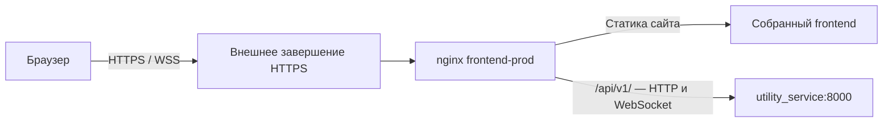

# INF-02: общий маршрут frontend, API и WebSocket

Дата: 2026-10-26.
Статус: принято пользователем 2026-10-26 сообщением «Принимаю»; реализовано по отдельному поручению. Результаты — в [отчёте](2026-10-26-inf-02-production-api-routing-implementation-report.md).
Основание: [анализ и семь уточнений](2026-10-26-inf-02-production-api-routing-analysis.md).
Следующий этап: [план реализации](2026-10-26-inf-02-production-api-routing-plan.md).

## Результат и согласованные границы

Production frontend из чистого build context должен обращаться к API через общий публичный адрес сайта. Сайт расположен в корне адреса. Работают HTTP API и существующий WebSocket-маршрут. Локальная воспроизводимая проверка покрывает вход, восстановление сессии, выход, список нарядов, workspace, Save → чтение результата → Revert и WebSocket.

HTTPS обеспечивает внешняя инфраструктура; самостоятельный HTTPS-стенд и новый CI gate не входят в задачу. INF-03 остаётся отдельной задачей. Не меняются доменные guards, cookie policy INF-01, production startup без demo seeds, отключение legacy API по умолчанию. Не добавляются realtime broadcast для Save/Revert, новые микросервисы или размещение сайта под префиксом.

## Предлагаемая схема

Использовать уже существующий nginx в frontend-prod как reverse proxy. API остаётся во внутренней сети Compose, отдельный публичный API port не нужен. Внешний HTTPS proxy передаёт frontend nginx исходные пути и поддерживает WebSocket upgrade. Порт 8080 остаётся внутренней точкой подключения внешнего proxy либо локальной проверки, а не обещанием production-авторизации по обычному HTTP.

Это наиболее прямое соответствие выбранному одному адресу. Альтернатива с абсолютным адресом API в каждой сборке сохраняет зависимость образа от адреса развёртывания. Отдельная runtime-конфигурация произвольного API добавляет механизм для сценария разных адресов, который пользователь не требует.

## Frontend: согласованное вычисление адресов

Предлагается единая небольшая функция разрешения API base URL для HTTP и WebSocket:

- Без явного `VITE_API_BASE_URL` production использует origin открытого сайта.
- Dev без явного значения сохраняет существующий fallback `http://localhost:8000`; demo override продолжает передавать свой адрес.
- Непустое явное значение сохраняет совместимость с существующей dev-конфигурацией. Относительное значение разрешается относительно origin страницы. Пустая строка трактуется как текущий origin, а не как повод вернуться к localhost.
- WebSocket URL строится от того же разрешённого HTTP(S) base: `http` → `ws`, `https` → `wss`. Путь остаётся `/api/v1/ws/layers/{id}`. Не оставлять независимый fallback на `ws://localhost:8000`.
- API-вызовы сохраняют существующие `/api/v1/...`; не добавлять второй `/api` и не удалять текущий префикс.

Результат для чистого production build: смена домена или порта не требует пересборки. Это техническое свойство принято вместе со спецификацией; отдельным исходным требованием пользователя оно не было. Изменять runtime env контейнера nginx для подстановки адреса не требуется: Vite подставляет `import.meta.env` при сборке. [Документация Vite](https://vite.dev/guide/env-and-mode).

Из-за отложенной INF-03 локальный env всё ещё может влиять на сборку. Гарантия INF-02 относится к чистому контексту без случайного API override; в runbook это ограничение указывается явно.

## nginx: сохранение API-контракта

Добавить собственный server configuration в production image через Dockerfile:

- Статика обслуживается из существующего `dist`.
- `/api/v1/` передаётся в `http://utility_service:8000` с исходным URI и query string. В `proxy_pass` не добавлять URI, который удалит `/api/v1/`. Такое поведение описано в [nginx proxy_pass](https://nginx.org/en/docs/http/ngx_http_proxy_module.html#proxy_pass).
- Для WebSocket явно задать `proxy_http_version 1.1`, передачу `Upgrade` и условного `Connection`. Это существенно для используемого образа nginx 1.27; современные defaults документации нельзя переносить на него без проверки. [nginx WebSocket](https://nginx.org/en/docs/http/websocket.html).
- Сохранить Authorization, Cookie, Set-Cookie, Content-Type, тело запроса и ответные коды. Ошибки API не заменять HTML страницы; не направлять неизвестные API endpoints в SPA fallback.
- Не переписывать cookie Path/SameSite/Secure. Не включать proxy cache для API и повторную отправку изменяющих запросов при ошибке upstream. Повторы Save/Revert остаются ответственностью текущего command/recovery contract.
- В access log для API не записывать query string: WebSocket ticket находится в URL. Для диагностики достаточно метода, пути без аргументов, статуса и времени; Authorization/Cookie/ticket не включаются в evidence.
- Явно документировать idle timeout WebSocket и проверить соединение дольше стандартных 60 секунд. Предлагаемый read timeout — 300 секунд; это timeout отсутствия данных, а не срок сессии. Проверить фактическую работу ping/reconnect, не обещать бесконечное соединение. [nginx WebSocket timeout](https://nginx.org/en/docs/http/websocket.html).

Healthcheck `/` сохраняет значение проверки frontend-процесса. Он не заменяет сквозную приёмку API. Публиковать backend `/health`, `/docs` и `/openapi.json` через новый публичный маршрут для исправления INF-02 не требуется.

Обычный restart API и изменение адреса контейнера — разные случаи. Минимальная реализация с разрешением upstream при старте nginx должна документировать необходимость перезапуска frontend после пересоздания API с другим IP. Автоматическое обнаружение таких изменений не считать доказанным без отдельной проверки; это не причина добавлять сервис обнаружения или новый компонент в INF-02.

## Внешнее HTTPS и авторизация

Внешний proxy обязан обслуживать единый HTTPS/WSS origin, сохранять пути `/api/v1/...`, query string для ticket, cookie и Authorization, поддерживать upgrade. Подключение к frontend nginx должно быть в контролируемой сети. TLS certificates и настройка этого внешнего компонента остаются вне реализации.

API должен продолжать работать с `DEV_MODE=false`, `AUTH_SESSION_COOKIE_SECURE=true`. Same-origin взаимодействие не требует расширять CORS wildcard или переводить cookie в `SameSite=None`. Не вводить доверие произвольным Forwarded headers: текущие cookie выставляются явно; если инфраструктуре понадобятся абсолютные redirects, схема доверенных proxy требует отдельной настройки.

Secure cookie требует HTTPS, кроме специального поведения localhost. Поэтому локальный browser smoke предлагается выполнять на `http://localhost:<port>` с настоящим Secure cookie без ручного его внедрения и без отключения browser security. Это проверка маршрута и auth-контракта в выбранном браузере, **не проверка внешнего TLS**. [MDN: Secure cookie](https://developer.mozilla.org/en-US/docs/Web/HTTP/Reference/Headers/Set-Cookie).

## Воспроизводимая локальная приёмка

Подготовить runner и runbook в `docs/sprint_2`. Использовать отдельный Compose project, уникальные имена контейнеров, отдельную disposable БД и свободный loopback port frontend. Не публиковать API port. Учитывать фиксированные container_name базового Compose, чтобы проверка не затронула рабочие контейнеры.

Чистый build context формируется во временном каталоге из текущих исходников с явным исключением env, node_modules и dist; исходные файлы пользователя не удаляются. Не использовать только HEAD как источник: будущие незакоммиченные изменения реализации тоже должны попасть в проверку. Записывать состав/идентификатор проверенного исходного состояния без секретов. Это изоляция проверки, а не исправление INF-03.

API и frontend собираются с target `prod`. Миграции и тестовые fixtures запускаются отдельно в disposable БД; production API startup не получает seed chain и не переводится в demo. Existing smoke/M4 могут предоставить сценарии и fixtures, но их dev Compose не подменяет production-конфигурацию.

| Проверка | Наблюдаемое доказательство |
| --- | --- |
| Страница и bundle | Браузер загружает production nginx; реальные API requests идут на origin страницы, а не на порт 8000 |
| Login и refresh | Cookie получена от backend через nginx; reload восстанавливает сессию и доступ к нарядам/workspace |
| Save/readback | Изменяется разрешённая внутренняя вершина fixture; Save успешен; после reload читается сохранённая геометрия, baseline неизменён |
| Revert | После подтверждения состояние возвращается к baseline; результат подтверждается новым чтением |
| Logout | Cookie очищена; попытка refresh больше не восстанавливает завершённую сессию |
| API errors | Без авторизации защищённый маршрут отклоняется; неизвестный API path возвращает API 404, а не HTML/200 |
| Legacy по умолчанию | Выдача ticket запрещена действующим feature flag |
| Разрешённый WebSocket | В отдельной фазе явно включён legacy API, получен ticket через общий origin; через тот же origin установлен WebSocket и получено сообщение `connected` |
| Ticket guard | Повтор использованного ticket и соединение без ticket отклоняются; proxy не обходит backend authentication |
| Устойчивость соединения | Соединение остаётся рабочим после 60 секунд; результат и длительность записаны, нет обещания бесконечного idle |
| URL resolver | Целевые frontend tests покрывают dev/prod, HTTP/HTTPS, нестандартный порт и отсутствие localhost fallback для production WSS |
| Регрессия dev | Явный `VITE_API_BASE_URL` из demo продолжает задавать HTTP и WebSocket адреса |

Полный Save/Revert запускать браузером из настоящего bundle; успешного curl/requests через nginx недостаточно, чтобы исключить прежний frontend defect. Legacy WebSocket допускается проверять отдельным browser/client probe, так как основной редактор Sprint 2 его не использует; URL resolver дополнительно проверяется тестами.

Unit checks, typecheck, lint/build и `nginx -t` дополняют интеграционный smoke. Новый CI job не добавляется. Завершение runner удаляет только принадлежащие ему ресурсы, сохраняя компактное evidence в `docs/sprint_2/evidence/inf-02`. В отчёте отдельно указываются проверенный браузер, версии образов, чистота context, реальные результаты и ограничения.

## Предполагаемая поверхность изменений

- `apps/frontend/src/api/http.ts` и небольшой общий resolver адреса.
- `apps/frontend/src/composables/map/useLayerRealtime.ts` и целевые tests.
- Собственный nginx configuration frontend и его подключение в `apps/frontend/Dockerfile`.
- Локальные проверочные артефакты и runbook в `docs/sprint_2`; индекс этой папки.

Base Compose уже обеспечивает внутреннюю связь сервисов, поэтому публикация API port и изменение бизнес-кода не нужны. Последовательность работ описана в [плане реализации](2026-10-26-inf-02-production-api-routing-plan.md). Этот документ не сообщает о выполненных проверках и не закрывает INF-02.
